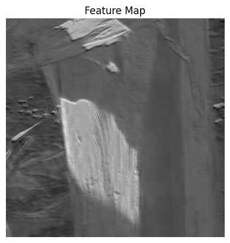
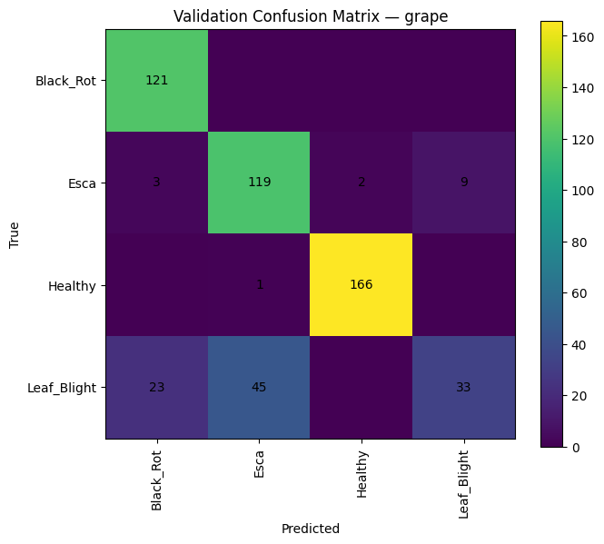

# 🌱 Crop-Aware CNN Baseline for Plant Disease Classification

### A first CNN for identifying 82 plant diseases across 18 crops, built and analysed step by step

> 🛠️ A **convolutional neural network built from scratch in PyTorch**, trained on **63,664 leaf images**. It is the baseline for my later [crop-aware ResNet-18](https://github.com/HemanthM2006/crop-aware-resnet18-plant-disease) experiment.

The project goes from the smallest building block (one convolution on one leaf) to a full training run, evaluation and error analysis.

---

## 🎯 Project Goal

Given a photo of a leaf **and the crop it comes from**, predict the disease:

```text
Input:   leaf image (128 × 128) + crop = "grape"
Output:  Black_Rot | Esca | Healthy | Leaf_Blight
```

The goals were to:

1. Understand what each CNN layer does to an image, one layer at a time
2. Build a **simple, honest baseline** that later models have to beat
3. Find out **where** and **why** the model makes mistakes, not just its accuracy

---

## 📊 Results at a Glance

| Metric | Value |
|---|---:|
| Validation accuracy | **90.99%** (9,550 images) |
| Test accuracy | **91.30%** (9,550 images) |
| Macro-F1, validation | 88.67% |
| Weighted-F1, validation | 90.91% |
| Parameters | 1,857,618 |
| Checkpoint size | 7.1 MB |

> Macro-F1 and weighted-F1 are averages of the per-class scores in [`results/validation_disease_metrics.csv`](results/validation_disease_metrics.csv).

⚠️ **These numbers are optimistic.** I later found that **1,397 of the 9,550 validation images (14.6%)** were exact, flipped or rotated copies of training images. The model can get those right by memory alone. See **Data Leakage (Found Later)** below.

---

# 📓 The Three Notebooks

### 1. `cnn_experiments.ipynb`: one layer at a time

Before building a full model, I passed a **single banana leaf** through each layer by hand and printed what changed:

```text
Image         3 × 256 × 256
   ↓ Conv 3×3 (8 filters)
Feature maps  8 × 254 × 254
   ↓ ReLU     → negative values become 0 (min −164.9 → 0.0)
   ↓ MaxPool  8 × 127 × 127
   ↓ Conv → ReLU → Pool (×2 more)
              32 × 30 × 30
   ↓ Flatten  28,800 values
   ↓ Linear   128 → ReLU → Linear 5
   ↓ Softmax  probabilities that sum to 1
```



### 2. `cnn_baseline.ipynb`: data, model and training

- Collects all 63,664 images and their crop/disease labels
- Finds very small classes (fewer than 50 or 100 images)
- Makes a stratified **70 / 15 / 15** split
- Compares three resize methods and picks one (below)
- Caches the preprocessed images to speed up training
- Builds and trains the crop-aware CNN for 30 epochs
- Digs into one weak class: grape Leaf_Blight

### 3. `cnn_evaluation.ipynb`: evaluation and inference

- Rebuilds the exact model and loads the saved weights (**no retraining**)
- Validation and test accuracy
- Per-crop accuracy, per-disease precision / recall / F1
- A confusion matrix for every crop
- The most confident mistakes and the most common confusions
- A `predict_single_image(image_path, crop_name)` function

---

# 🌾 Dataset

| | |
|---|---|
| Images | 63,664 |
| Crops | 18 |
| Crop-disease classes | 82 |
| Split (stratified by crop and disease, seed 42) | 44,564 train / 9,550 validation / 9,550 test |

- [`data/class_mapping.json`](data/class_mapping.json) lists every crop and its diseases.
- [`data/dataset_inventory.csv`](data/dataset_inventory.csv) has the image counts from the original source datasets.

> The images themselves are **not included** in this repo.

---

# 🖼️ Preprocessing: How to Make Every Image 128 × 128

The images come in many sizes, and not all of them are square. I compared three options:

```text
Direct resize        → fast, but stretches non-square leaves
Thumbnail            → keeps the shape, but the size varies
Thumbnail + padding  → keeps the shape and gives a fixed 128 × 128  ✅
```

Every image is padded to 128 × 128 with black borders using `ImageOps.pad`, then scaled from 0–255 to 0–1.

For training, the padded images were saved once as a `uint8` NumPy cache (about 2 GB). Each epoch then reads from that file instead of decoding 44,564 JPEGs again.

---

# 🏗️ Architecture

```text
Input 3 × 128 × 128
   │
ConvBlock(3 → 64)      Conv 3×3 → BatchNorm → ReLU → MaxPool 2×2   →  64 × 64 × 64
ConvBlock(64 → 128)                                                → 128 × 32 × 32
ConvBlock(128 → 256)                                               → 256 × 16 × 16
ConvBlock(256 → 512)                                               → 512 ×  8 ×  8
   │
Global average pooling                                             → 512
Linear 512 → 512 → ReLU → Dropout(0.5)                             → 512
   │
Crop-specific head: Linear 512 → number of diseases for that crop
```

### Why one head per crop?

There are **18 heads** (one per crop), with 82 outputs in total. The crop label decides which head an image goes through:

```python
for crop_index in torch.unique(crop_labels):
    mask = crop_labels == crop_index
    outputs[crop_index] = self.disease_heads[crop_index](x[mask])
```

- The model never has to choose between diseases of **different** crops. A grape leaf can only be labelled with a grape disease.
- The same disease name under two crops (for example `Bacterial_Blight` in cotton and soybean) is treated as two separate classes.
- **The trade-off:** the crop has to be provided when making a prediction.

---

# ⚙️ Training Setup

| Setting | Value |
|---|---|
| Loss | Cross-entropy per crop head, summed and divided by batch size |
| Optimiser | Adam, learning rate 0.001 |
| Batch size | 32 |
| Epochs | 30 |
| Augmentation | Random horizontal flip |
| Precision | Mixed precision (fp16 autocast + GradScaler) |
| Hardware | NVIDIA GeForce RTX 3050 Laptop GPU |

---

# 🌍 Validation Accuracy per Crop

| Crop | Images | Accuracy |
|---|---:|---:|
| wheat | 129 | 99.22% |
| mango | 300 | 99.00% |
| chilli | 211 | 98.10% |
| pomegranate | 764 | 96.47% |
| cotton | 140 | 96.43% |
| banana | 524 | 95.61% |
| turmeric | 97 | 94.85% |
| potato | 2,327 | 94.50% |
| groundnut | 258 | 91.86% |
| pea | 1,678 | 89.21% |
| paddy | 1,106 | 88.79% |
| okra | 225 | 88.00% |
| soybean | 76 | 86.84% |
| sugarcane | 378 | 85.45% |
| grape | 522 | 84.10% |
| tomato | 320 | 80.31% |
| maize | 371 | 80.05% |
| pigeon pea | 124 | 79.03% |

---

# 🔬 Error Analysis

### Case study: grape Leaf_Blight

Grape Leaf_Blight was the weakest class: **recall 32.67%**. Only 33 of its 101 validation images were recognised.



Of the 68 Leaf_Blight leaves it got wrong:

- **45** were predicted as **Esca**
- **23** were predicted as **Black_Rot**

All three are dark, spotty leaf diseases, so at 128 × 128 the differences are subtle.

### Most common confusions across all crops

| Crop | Actual | Predicted as | Count |
|---|---|---|---:|
| pea | Ascochyta_Blight | Botrytis_Blight | 126 |
| potato | Early_Blight | Late_Blight | 54 |
| grape | Leaf_Blight | Esca | 45 |
| potato | Late_Blight | Early_Blight | 42 |
| maize | Maize_Streak_Virus | Maize_Leaf_Spot | 23 |
| grape | Leaf_Blight | Black_Rot | 23 |

Out of 860 wrong validation predictions, pea Ascochyta_Blight vs. Botrytis_Blight alone accounts for 126. Early vs. late blight on potato is the next biggest mix-up, in both directions.

### Weakest classes (validation)

| Crop | Disease | Precision | Recall | F1 | Images |
|---|---|---:|---:|---:|---:|
| grape | Leaf_Blight | 78.57% | 32.67% | 46.15% | 101 |
| pigeon pea | Sterility_Mosaic | 100.00% | 40.91% | 58.06% | 44 |
| maize | Healthy | 51.16% | 68.75% | 58.67% | 32 |
| soybean | Cercospora_Leaf_Blight | 87.50% | 46.67% | 60.87% | 15 |
| pea | Stem_Rot | 100.00% | 50.00% | 66.67% | 6 |

---

# ⚠️ Data Leakage (Found Later)

While building the ResNet-18 experiment, I hashed every training image and compared it with each validation image, including flipped and rotated versions:

- **1,397 of 9,550 validation images (14.6%) were copies of training images.**
- **All 121** grape Black_Rot validation images were copies. That explains its perfect row in the confusion matrix above.
- **75 of the 101** grape Leaf_Blight images were copies too.
- **220 of 225** okra images were copies.

So the baseline's validation accuracy (and probably its test accuracy, which hasn't been checked yet) is **higher than its true performance on new leaves**.

The full breakdown and the cleaned evaluation are in the [ResNet-18 repo](https://github.com/HemanthM2006/crop-aware-resnet18-plant-disease#-finding-copies-of-training-images-in-the-validation-set).

---

# 🧠 Key Lessons

### 1️⃣ Look at one layer before building the whole network

Printing shapes and feature maps for one image made the full model much easier to reason about.

### 2️⃣ Preprocessing is a design decision

Stretching a leaf changes the shape of its spots. Padding keeps the shape.

### 3️⃣ Caching matters on a laptop GPU

Decoding JPEGs every epoch was the bottleneck. A memory-mapped `.npy` cache fixed it.

### 4️⃣ Accuracy hides the weak classes

An overall accuracy of 91% sat next to 33% recall on grape Leaf_Blight. Per-class metrics and confusion matrices showed what the headline number didn't.

### 5️⃣ Check your splits for duplicates

A random split is not enough when a dataset contains copies of the same image. This turned out to be the most important lesson of the project.

---

# 📁 Project Structure

```text
crop-aware-cnn-plant-disease-baseline/
│
├── notebooks/
│   ├── cnn_experiments.ipynb   ← one convolution at a time
│   ├── cnn_baseline.ipynb      ← data, split, model, training
│   └── cnn_evaluation.ipynb    ← evaluation, error analysis, inference
│
├── results/
│   ├── summary.csv                      ← validation and test accuracy
│   ├── validation_crop_metrics.csv      ← accuracy per crop
│   └── validation_disease_metrics.csv   ← precision / recall / F1 per class
│
├── data/
│   ├── class_mapping.json
│   └── dataset_inventory.csv
│
├── assets/
│   ├── feature_map.png
│   └── confusion_grape.png
│
├── requirements.txt
└── README.md
```

Not included: the image dataset, the image caches, the trained weights and the per-image prediction files. `cnn_evaluation.ipynb` regenerates the predictions.

---

# 🚀 How to Run

### 1. Clone the repository

```bash
git clone https://github.com/HemanthM2006/crop-aware-cnn-plant-disease-baseline.git
cd crop-aware-cnn-plant-disease-baseline
```

### 2. Install dependencies

```bash
pip install -r requirements.txt
```

For GPU training, install the CUDA build of PyTorch from [pytorch.org](https://pytorch.org/get-started/locally/).

### 3. Add the dataset

Place the images as `disease_dataset/processed/<crop>/<disease>/*.jpg` in the folder above `notebooks/`.

### 4. Update the paths and run

The notebooks point to my local drive (`D:\Intelligent_farming_system\...`) for the cache and model files. Change these paths in the first cells, then run:

```text
cnn_experiments.ipynb  →  cnn_baseline.ipynb  →  cnn_evaluation.ipynb
```

---

# 🛠️ Tech Stack

```text
Python
│
├── PyTorch        → model, training, mixed precision
├── NumPy          → image cache
├── Pillow         → loading, resizing, padding
├── scikit-learn   → stratified split, metrics, confusion matrix
├── Pandas         → results tables
└── Matplotlib / Seaborn → plots

Jupyter Notebook
```

---

# 🚀 What's Next?

The next experiment replaces the plain CNN with a deeper residual network and evaluates it on a cleaned validation set:

```text
Crop-aware CNN baseline   ✅  (this repo)
        ↓
Crop-aware ResNet-18      ✅  → crop-aware-resnet18-plant-disease
        ↓
Pretrained ResNet + deduplicated splits
```

---

# 👨‍💻 Built By

**Hemanth M**

*Computer Science Student • Machine Learning Enthusiast*

> 🌱 Part of the disease-detection work for the **Intelligent Farming System** project, and of my journey from traditional ML into deep learning.
